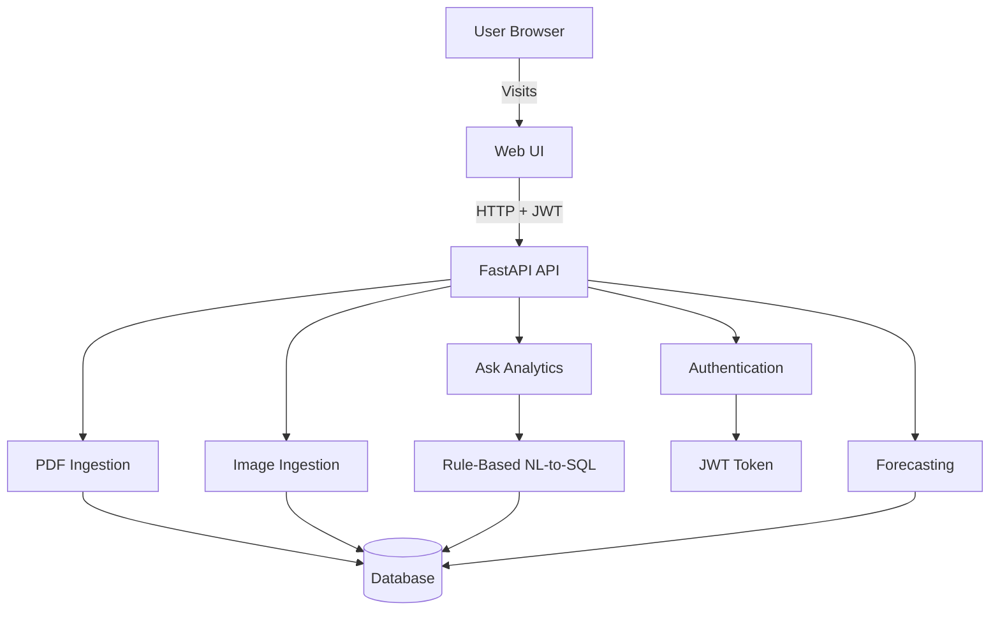

# Asklytics

Asklytics is a full-stack financial analytics application that allows users to ingest financial data from PDFs and images, explore it through an interactive React dashboard, and query financial information using a chat-style interface that returns validated SQL results.

**Repository & Contributed :** [github.com/yuvraj20gole/Asklytics](https://github.com/yuvraj20gole/Asklytics)

---

## Features

- **Authentication:** JWT-based user registration and login.
- **Chat Analytics:** `/ask` uses rule-based Natural Language to SQL (NL-to-SQL) conversion with query validation and safe execution.
- **PDF Ingestion:** Extracts and validates financial tables from PDF documents.
- **Image Ingestion:** OCR-based financial data extraction using EasyOCR with layout-based fallback.
- **Forecasting:** Uses a PyTorch Multi-Layer Perceptron (MLP) to forecast revenue based on ingested financial data.

---

## Architecture



---

## Tech Stack

| Category | Technologies |
|---|---|
| Backend | Python, FastAPI, SQLAlchemy, Pydantic, Uvicorn |
| Frontend | React, TypeScript, Vite |
| Database | SQLite (default), PostgreSQL |
| Machine Learning | PyTorch |
| OCR & Image Processing | EasyOCR, OpenCV |
| Authentication | JWT |
| Deployment | Render |

---

## Getting Started

### Prerequisites

Make sure you have the following installed:

- **Python:** 3.11+ (3.12 recommended; use a native ARM64 interpreter on Apple Silicon).
- **Node.js:** 18+.
- **npm:** Included with Node.js.

### 1. Clone the Repository

```bash
git clone https://github.com/yuvraj20gole/Asklytics.git
cd Asklytics
```

### 2. Set Up the Backend

Create and activate a virtual environment:

**macOS / Linux:**

```bash
python3 -m venv .venv
source .venv/bin/activate
```

**Windows:**

```bash
python -m venv .venv
.venv\Scripts\activate
```

Install backend dependencies:

```bash
pip install -r backend/requirements.txt
```

### 3. Configure Environment Variables

Create the `.env` file in the repository root:

```bash
cp .env.example .env
```

On Windows, you can also copy `.env.example` manually and rename the copy to `.env`.

Configure the required environment variables as described below.

### 4. Start the Backend

From the repository root, run:

```bash
PYTHONPATH=backend uvicorn app.main:app --reload --host 0.0.0.0 --port 8000
```

### 5. Set Up the Frontend

Open another terminal:

```bash
cd web
npm install
```

Start the React development server:

```bash
VITE_API_BASE="http://localhost:8000" npm run dev
```

### 6. Access the Application

| Service | URL |
|---|---|
| Frontend | http://localhost:5173 |
| Backend API | http://localhost:8000 |
| API Documentation | http://localhost:8000/docs |

---

## Environment Variables

Configure the following backend environment variables in the root `.env` file:

| Variable | Description | Required |
|---|---|---|
| `JWT_SECRET_KEY` | Secret key used for JWT authentication. | Yes |
| `DATABASE_URL` | Database connection string. Defaults to SQLite. | No |
| `CORS_ALLOW_ORIGINS` | Comma-separated list of permitted frontend origins. | Recommended |

**Example:**

```env
JWT_SECRET_KEY=your-secure-secret-key
DATABASE_URL=sqlite:///./local.db
CORS_ALLOW_ORIGINS=https://your-site.com
```

For PostgreSQL, configure `DATABASE_URL` with your PostgreSQL connection string.

---

## Deployment (Render)

Asklytics can be deployed using Render with the repository's `render.yaml` Blueprint configuration.

### Deployment Steps

1. Open the [Render Dashboard](https://dashboard.render.com/).
2. Select **New → Blueprint**.
3. Connect your GitHub repository.
4. Render will detect the `render.yaml` configuration and create the required services.
5. Once the API service is deployed, copy its public URL (for example, `https://asklytics-api.onrender.com`).
6. Open the static web service and navigate to **Environment**.
7. Set `VITE_API_BASE` to your backend API URL without a trailing slash.
8. Trigger a **Manual Deploy** for the frontend.
9. Open the API service's environment settings.
10. Set `CORS_ALLOW_ORIGINS` to the exact deployed frontend origin (for example, `https://asklytics-web.onrender.com`).

**Important:**
- `JWT_SECRET_KEY` is automatically generated through the Blueprint configuration unless manually overridden.
- Ensure that frontend and backend URLs are configured correctly.
- Never expose secret environment variables in frontend code.

---

## API Overview

All API endpoints use the `/api/v1` prefix.

| Module | Method | Endpoint | Description |
|---|---|---|---|
| Authentication | POST | `/auth/register` | Register a new user. |
| Authentication | POST | `/auth/login` | Authenticate a user and return a JWT. |
| Ask Analytics | POST | `/ask` | Convert natural-language questions into validated SQL queries and return results with explanations. |
| PDF Ingestion | POST | `/ingest/pdf` | Upload a PDF using multipart form fields: `company` and `file`. |
| Image Ingestion | POST | `/ingest/image` | Upload a JPG, JPEG, or PNG image for OCR-based extraction. |
| Forecasting | GET | `/ml/revenue-forecast` | Generate revenue forecasts using previously ingested financial data. |

**Authentication:** The Ask Analytics endpoint requires a valid JWT token.

**Note:** The image extraction pipeline is under active development.

---

## Troubleshooting

### Database Errors After Schema Changes

During local development, if database schema changes cause compatibility issues:

1. Stop the backend server.
2. Delete `local.db`.
3. Restart the backend server.

**Warning:** Deleting `local.db` permanently removes the local database contents. Do this only in development.

### CORS Errors

- Verify that `CORS_ALLOW_ORIGINS` contains the exact frontend origin.
- Check that the backend CORS configuration allows your frontend domain.
- Local Vite development origins on `localhost` ports `517x` are supported in `backend/app/main.py`.

### Environment Variable Issues

- Verify that `.env` exists in the repository root.
- Ensure `JWT_SECRET_KEY` is configured.
- Restart the backend after modifying environment variables.
- Never commit `.env` or expose credentials publicly.

---

## Development Notes

- **Debug Artifacts:** The `debug_output/` directory is ignored by Git and can be used locally to store OCR and PDF debugging artifacts.
- **EasyOCR:** Downloads its model weights automatically during the first execution. This may require downloading several tens of megabytes.
- **Database:** SQLite is used by default. PostgreSQL can be configured through `DATABASE_URL`.

---

## License

No license file is currently included in this repository.

If you plan to distribute or open-source Asklytics, consider adding a license such as the [MIT License](https://opensource.org/license/mit/).

---

**Built with Python, FastAPI, React, TypeScript, and PyTorch.**
